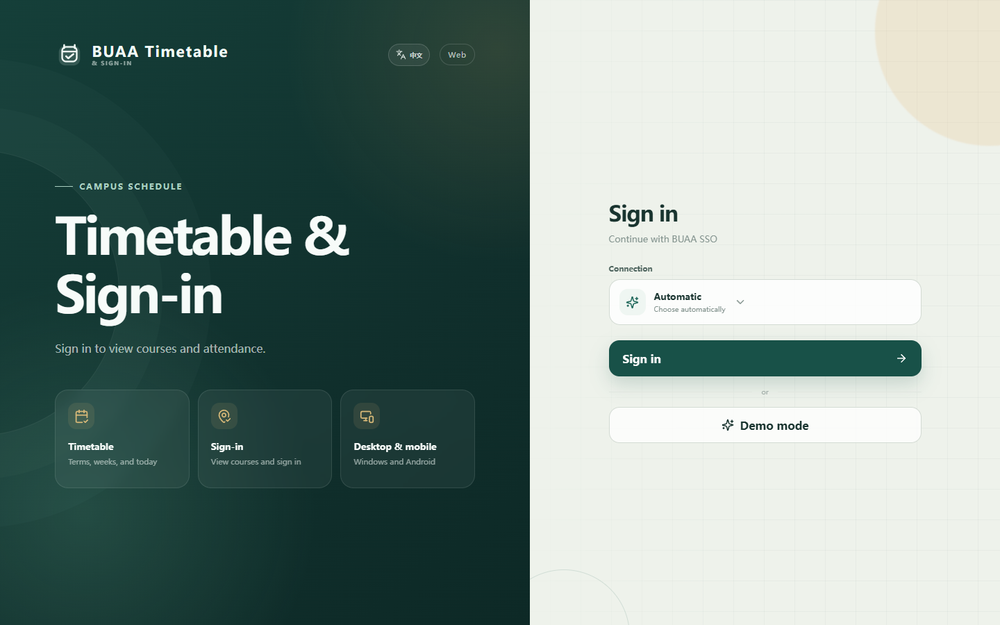
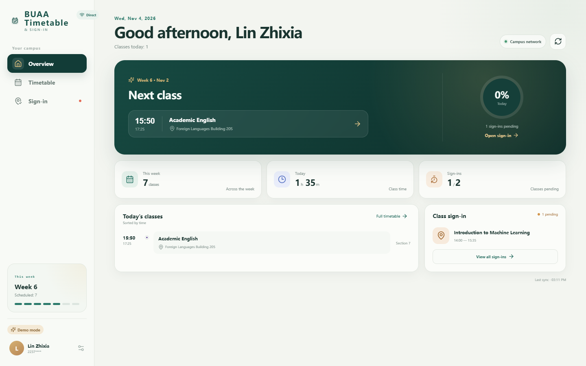
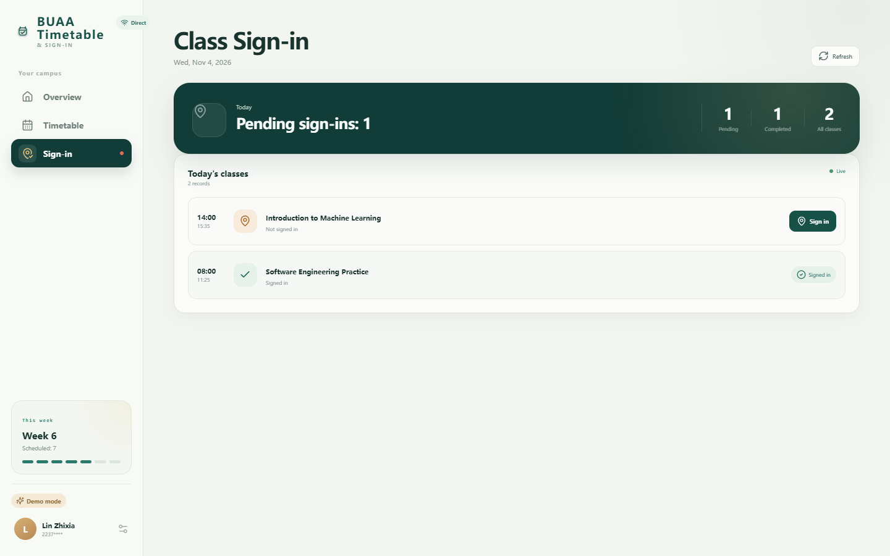

# BUAA Timetable & Sign-in

A bilingual Windows and Android client for BUAA timetables and classroom sign-in. The app connects directly to BUAA services and does not require a self-hosted server.

> Unofficial student project. Not affiliated with Beihang University.







## Features

- BUAA SSO login in an isolated authentication window
- Undergraduate and graduate timetable support
- Term, week, and today views
- Classroom sign-in status and one-click sign-in
- Direct campus access with automatic WebVPN fallback
- Chinese and English UI with one-click language switching
- Offline timetable snapshot
- Windows tray mode and Android foreground service
- Automatic sign-in when a class becomes available

## Background auto sign-in

Enable **Background auto sign-in** in Settings. The app checks sign-in availability every 60 seconds and submits sign-in for the current account as soon as it becomes available.

- On Windows, closing the window keeps the app running in the system tray.
- On Android, a foreground service keeps checking after the app is closed.
- Android shows its required foreground-service status notification. Successful sign-ins are submitted silently.

## Downloads

- [Windows installer](https://github.com/ZhuangHT-1201/BUAA-Timetable-Signin/releases/latest)
- [Android APK](https://github.com/ZhuangHT-1201/BUAA-Timetable-Signin/releases/latest)

## Development

Requirements:

- Node.js 22.12+
- JDK 21
- Android SDK 35

```bash
npm install
npm run dev:desktop
```

Web preview:

```bash
npm run dev
```

## Test

```bash
npm run typecheck
npm test
npm run build:web
```

## Build

Windows:

```bash
npm run build:desktop
```

Android:

```bash
npm run build:android
```

Artifacts are written to `release/` and `android/app/build/outputs/apk/debug/`.

## Structure

```text
src/          React UI, i18n, timetable and sign-in logic
electron/     Windows shell, authentication and tray mode
android/      Capacitor app and native background auto sign-in
tests/        Unit tests
docs/         Privacy, architecture and release documentation
```

## License

[MIT](LICENSE)

See [Third-Party Notices](THIRD_PARTY_NOTICES.md).
